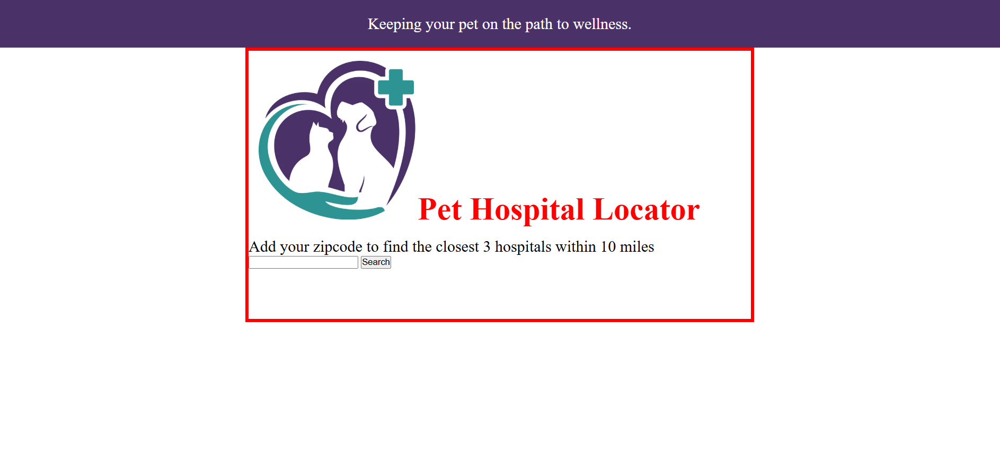
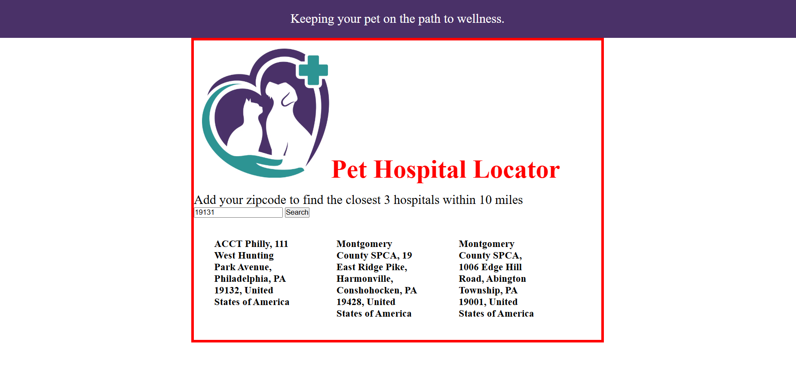

# 🐾 Pet Hospital Locator

## Project Description

Pet Hospital Locator is a web application that helps users find the nearest pet hospital by zipcode. It uses the Geocod.io API to convert a ZIP code into geographic coordinates, then sends those coordinates to the Geoapify API to retrieve the nearest hospitals by name and address.

The application displays the closest 3 hospitals within 10 miles.
## Tech Stack

- **HTML** 
- **CSS**
- **JavaScript**

## How to Run or View It

1. Clone or download the repository.
2. Open `index.html` in a browser or serve the project using a local development server.
3. Enter a ZIP code in the search field.
4. Click **Search** to retrieve 3 closest hospitals in the area within 10 miles

The application requires an internet connection to access its external APIs. API availability and credential requirements may affect the results.

## Screenshots and Demo

### Application Interface

The interface includes a ZIP-code search field, the three closest hospitals
