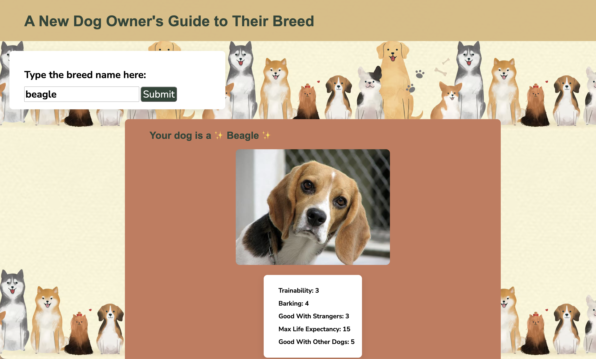

# 🐾  Dog Health Tips

A simple site sharing general health and character tips for dogs. Built with plain HTML, CSS, and JavaScript.

### Project Description

This project is a dog health tips page. It presents a collection of practical tips for keeping a dog healthy — things like exercise, diet, vet visits, and grooming — with each tip in its own card so the page is easy to scan. It was built as a learning project to practice semantic HTML, CSS layout with flexbox or grid, and writing content that's readable on both desktop and mobile. The styling is warm and friendly to match the subject.

### Live Link
To access the link, check the about section of this repo or [CLICK HERE](https://priscilla-ruilova.github.io/Dog-Health-Tips/).



### Features:

- **Tip cards** — each health tip is displayed in its own card with a heading and a short explanation.
- **Responsive layout** — cards reflow into a single column on smaller screens.
- **Custom styling** — a hand-written stylesheet in `assets/styles.css` and a Google Fonts stack.
- **Static site** — one `index.html`, no build step, no dependencies to install.
- **No API, no dependencies** — the whole site is static, so it loads instantly.

### Tech Used:

- **Frontend:** HTML, CSS, JavaScript (vanilla, no framework)
- **Layout:** CSS flexbox
- **APIs:** dog.ceo for images; api.api-ninjas.com/v1/dogs for dog facts
- **Hosting:** GitHub Pages

### Things I Learned:

- Semantic HTML:
  - Using headings in order and grouping each tip in its own section so the page is readable by screen readers and search engines.
- CSS layout:
  - Using flexbox to make a card layout that wraps on its own, instead of positioning each card by hand.
- Fetching APIs
  - Chaining two API requests so the output of the first call feeds the second, using the result of a breed lookup to build the URL for the next request.

### How to Use:

1. Clone this repository:
```bash
git clone https://github.com/priscilla-ruilova/Dog-Health-Tips.git
```

2. Navigate to the project:
```bash
cd Dog-Health-Tips
```

3. Open `index.html` in your browser — no install step needed!

4. Make it your own!
- Add your own tips to the list in `index.html`.
- Consider adding a filter or category buttons so visitors can jump to diet, exercise, or grooming tips.
- Try changing the styling in `assets/styles.css` to make it your own.
