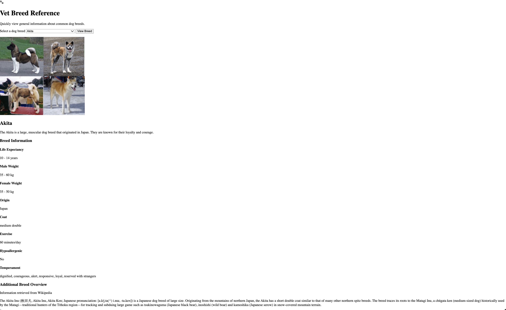

# 🐾 Vet Breed Reference
 
A quick dog-breed reference for veterinary practice staff. Pick a breed to see its life span, weight ranges, coat, exercise needs, and temperament, plus a Wikipedia summary and photo.
 

🔗 **Live Demo:** [kareemahb.github.io/complex-api-veterinary-practice](https://kareemahb.github.io/api-veterinary/)
 

 

 
## ✨ Features
 
- **Breed dropdown** filled from the API when the page loads, sorted A to Z
- **Breed details card**:
  - Description
  - Life span
  - Male and female weight ranges (kg)
  - Country of origin
  - Coat length and type
  - Daily exercise
  - Whether the breed is hypoallergenic
  - Temperament
- **Wikipedia summary and photo** for the selected breed
- **Fallbacks**: missing fields show "Unknown" or "Not available" instead of breaking the page
- **Status messages** while loading and when no breed is selected
- **Disclaimer** that the information is general reference only

 
## 🔍 How It Works
 
The app chains two free public APIs. Neither one needs an API key.
 
1. **[Dog API](https://dogapi.dog/)**: on page load, the app gets the full breed list and fills the dropdown. Selecting a breed shows its details from this data.
2. **[Wikipedia API](https://www.mediawiki.org/wiki/API:Main_page)**: the **breed name from the Dog API** is used to search Wikipedia. The app shows the first result's 3-sentence intro and thumbnail image.
```
Dog API ──▶ breed list ──▶ user picks a breed ──▶ breed name ──▶ Wikipedia search ──▶ summary + photo
```
 
All the logic lives in one `VetBreedApp` class:
 
| Method | Job |
| --- | --- |
| `loadBreeds()` | Gets the breed list from the Dog API |
| `populateBreedSelect()` | Sorts the breeds and builds the dropdown options |
| `handleSubmit()` | Finds the selected breed, then calls the display and Wikipedia methods |
| `displayBreed()` | Fills in the breed details card |
| `loadWikipediaInfo()` | Searches Wikipedia and shows the summary and image |
 

 
## 🛠️ Tech Stack
 
- HTML5
- CSS3
- JavaScript (ES6 classes, `async`/`await`, Fetch API, optional chaining `?.`, nullish coalescing `??`)
- [Dog API](https://dogapi.dog/) and the [Wikipedia API](https://www.mediawiki.org/wiki/API:Main_page)
No frameworks, dependencies, or build tools.
 

 
## 📁 Project Structure
 
```
api-veterinary/
├── index.html   # Breed form, details card, Wikipedia section, disclaimer
├── main.css     # Styling
├── main.js      # VetBreedApp class
└── image.png    # README screenshot
```
 
 
## 🚀 Getting Started
 
Try it live on **[GitHub Pages](https://kareemahb.github.io/api-veterinary/)**, or run it locally:
 
```bash
git clone https://github.com/kareemahb/api-veterinary.git
cd complex-api-veterinary-practice
```
 
Open `index.html` in your browser, or use the **Live Server** extension in VS Code.
 

 
## 💡 What I Learned
 
- Chaining API calls so data from the first API becomes the input for the second
- Building a long query URL for the Wikipedia API with search, extract, and image options
- Handling missing data safely with optional chaining (`?.`) and nullish coalescing (`??`)
- Organizing a front-end app in a class with one method per job
- Showing loading and error states so the user always knows what's happening

 
## ⚠️ Disclaimer
 
This app is for general reference only. It is not veterinary advice. Data comes from public sources (Dog API and Wikipedia) and may be incomplete.
 

 
## 👩‍💻 Created By
 
**Kareemah Bahaadur**
[GitHub](https://github.com/kareemahb)
 
