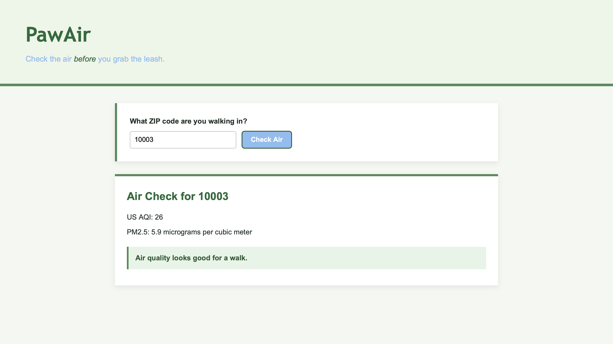

# 🐾 Project: Complex API 1 - Veterinary Practice

### Goal: Build a simple front-end app that uses data returned from one api to make a request to another api to create something that would be beneficial to a veterinary practice.

### How to submit your code for review:

- Fork and clone this repo
- Create a new branch called answer
- Checkout answer branch
- Push to your fork
- Issue a pull request
- Your pull request description should contain the following:
  - (1 to 5 no 3) I completed the challenge
  - (1 to 5 no 3) I feel good about my code
  - Anything specific on which you want feedback!

Example:
```
I completed the challenge: 5
I feel good about my code: 4
I'm not sure if my constructors are setup cleanly...
```

---

## My Solution

**PawAir - Check Before Walks** is a front-end application that helps dog owners check local air conditions before taking their dog outside.

The application takes a ZIP code entered by the user, retrieves relevant location and environmental data through APIs, and presents the returned information in an easy-to-understand format to help users make a more informed decision before heading out for a walk.



## How It's Made

**Tech used:** HTML, CSS, JavaScript, APIs

The application accepts a ZIP code through the search interface and makes an API request for location-related data. Returned data is then used in a subsequent request to retrieve air-quality information, demonstrating how data from one API can be used as input for another API. JavaScript handles the asynchronous requests, processes the returned data, and dynamically renders the results to the DOM.

## What I Learned

This project gave me additional practice chaining API requests, working with dynamic user input, handling asynchronous JavaScript, extracting and processing returned API data, and rendering useful information to the DOM.