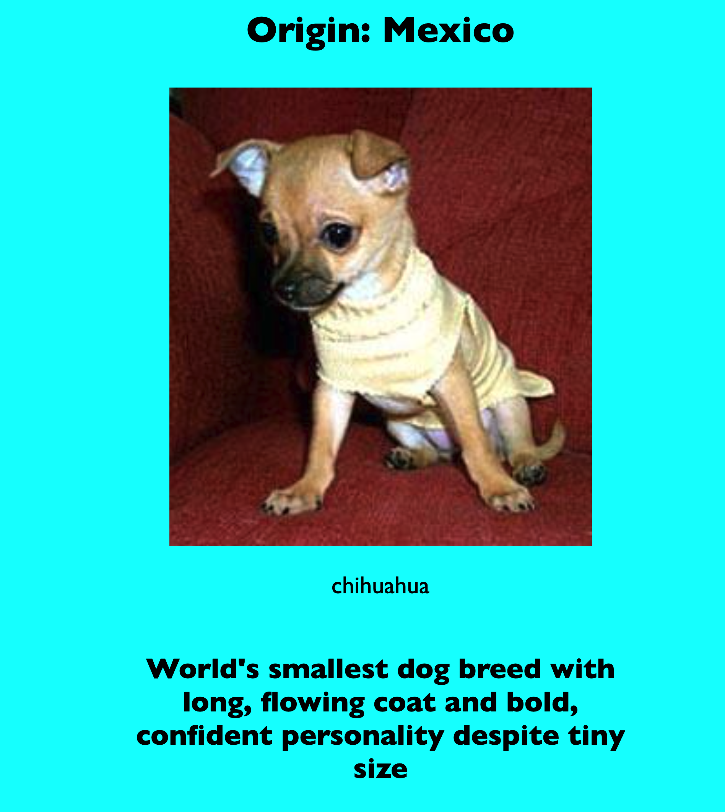

# Veterinary Practice App

A front-end app that uses two APIs' data for looking up dog breed information to help a veterinary practice. 
Data from The Dog api is used to make a request to the Dog Ceo api; once staff enters a dog breed, it shows information of that breed. 

- Check out here: 

 https://veterinary-practice.vercel.app/
 
- Screenshots:





## How It's Made

**Tech Used:** HTML, CSS, JavaScript, DogApi, Dog Ceo Api.

The app uses JavaScript's `fetch()` to call the dog api first. 
It then takes the data from that response and uses it to make a second request to dog ceo , and displays the combined result on the page.

## Getting Started

1. Clone this repository

```bash
   git clone https://github.com/sabrinalindev/veterinary-practice.git
```

2. Open `index.html` in your browser

## How to Use

1. Enter a dog breed
2. Press the Enter button
3. Origin, image, and important info about the breed will show up 

## Features

- Displays breed information and a photo
- Search by dog breeds
- No installation or dependencies needed

## Why This Stack

- **JavaScript (`fetch`)**: Handles both API requests and renders the combined data dynamically without a page reload.
- **HTML/CSS**: Simple, fast to load, and perfect for a lightweight front-end app.
- **The Dog Api**: this api includes lots of information of dog breeds
- **Dog Ceos**: This api includes image data of dog breeds.

## Future Improvements

-  Add search history or favorites
-  Build pet profile and record
