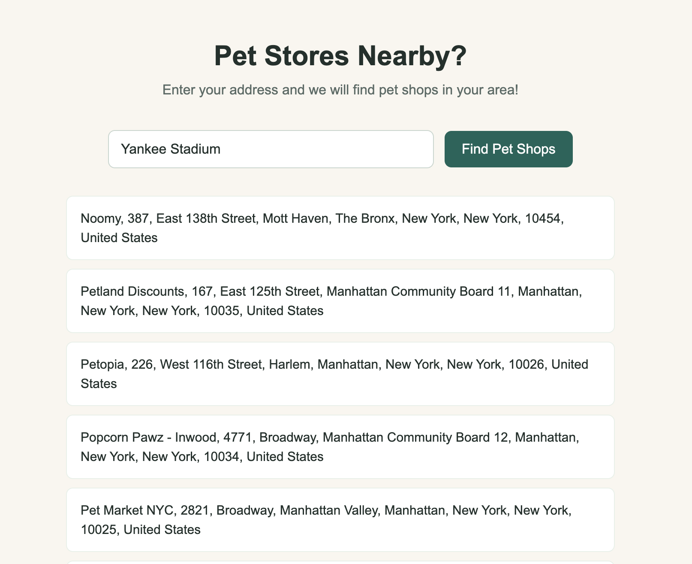

# Pet Stores Nearby

Enter an address and get a list of pet shops near it.

Live Link: https://tbrown320.github.io/complex-api-veterinary-practice/



## What it does

- Takes an address and geocodes it to latitude and longitude with the Geocode API.
- Finds pet shops within 10,000 metres of that location with the LocationIQ Nearby API and lists their names.

## Tech stack

- HTML, CSS, JavaScript (no build step, no server)
- Geocode API (`geocode.maps.co`) — address to coordinates
- LocationIQ Nearby API — pet shops near those coordinates

## How to run it

Open `index.html` in a browser, type an address, and click **Find Pet Shops**.

## Project structure

```
index.html      - address input, button, and the store list
css/style.css   - page styling
js/main.js      - geocoding, pet shop lookup, and rendering the list
```

---

Thay Brown — thaybrown22@gmail.com · https://thaythecoder.netlify.app · https://github.com/tbrown320 · https://www.linkedin.com/in/thaybrown
