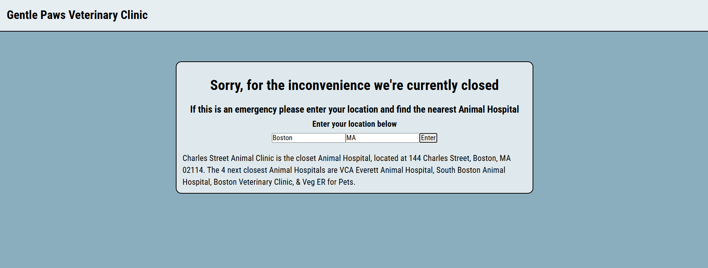

# Emergency Vet Finder

A simple front-end web app that helps pet owners find nearby veterinary clinics and animal hospitals by ZIP code. A vet practice can share it with clients for times when the practice is closed, like nights, weekends, or holidays, so they know where to go in an emergency.

## Why It's Useful

When a pet has an emergency after hours, the owner often calls their regular vet and gets a voicemail. Pointing clients to this app, from the practice's website, voicemail message, or after-hours sign, gets them to nearby care quickly and takes stress off the practice's staff.

## How It Works

This app chains two APIs together:

1. The user enters their **ZIP code**.
2. **Zippopotam.us** turns the ZIP code into a place name and its latitude and longitude.
3. Those coordinates are sent to the **Geoapify Places API**, which searches for veterinary clinics near that location.
4. The results are displayed on the page as a list of nearby vets with their names and addresses.

## How It's Made

**Tech used:** HTML, CSS, JavaScript

**APIs:**
- [Zippopotam.us](https://api.zippopotam.us): converts a ZIP code to coordinates (no API key needed)
- [Geoapify Places API](https://www.geoapify.com/places-api/): finds veterinary locations near those coordinates