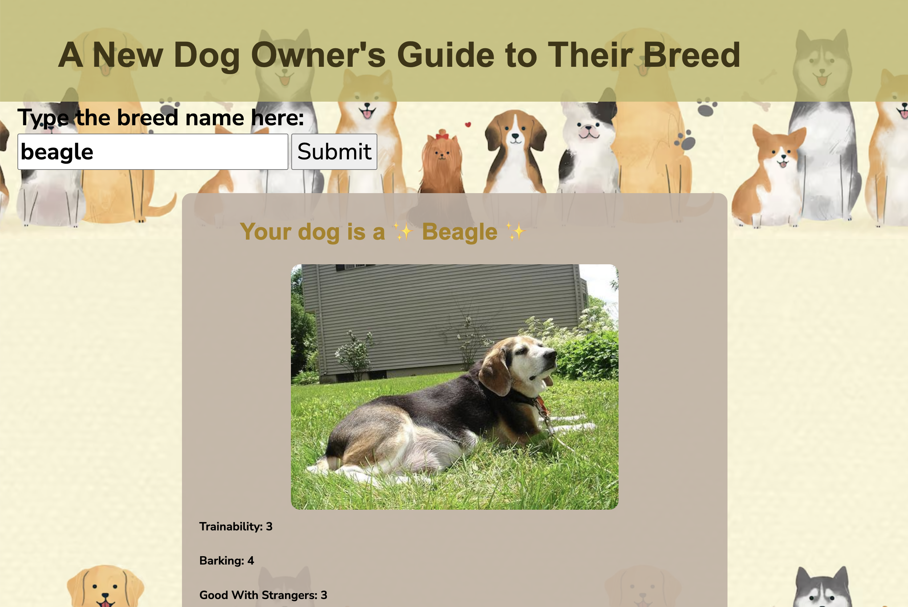

# 🐾 Project: Complex API 1 - Veterinary Practice

### Goal: Build a simple front-end app that uses data returned from one api to make a request to another api to create something that would be beneficial to a veterinary practice.

### Project Description: My project used a free yet limited dog breed API to get information about the dog breed's general characteristics. The dog breed output from the first API is then used to obtain a corresponding dog image from the DogCEO API. The user can read a short factsheet about their dog of choice, giving some form of reassurance and whimsy to new pet owners.

### Issues I ran into include:
- The initial API breaks down names down into their sub breeds which confuses the second API 
- The Dog CEO API does not have some common dog names (e.g. golden retriever)

### Tech Stack:
- HTML, CSS, JavaScript

### How to Use: 
- Enter a dog breed into the search bar (not all dog breeds are included in the API)
- Click submit and reach about your dog breed's abilities (scored from 1-5) including: 
    - Trainability
    - Barking
    - Good with Strangers
    - Max Life Expectancy (avg age)
    - Good With Other Dogs 
- To access the link, check the about section of this repo or [CLICK HERE](https://priscilla-ruilova.github.io/Dog-Health-Tips/).